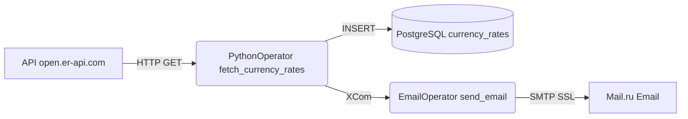
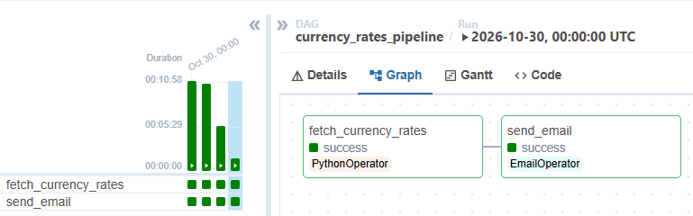
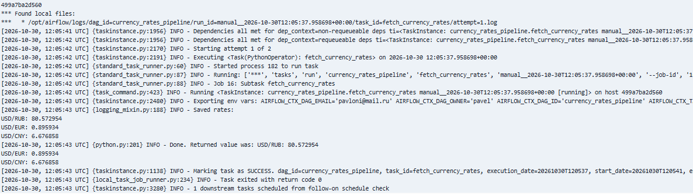
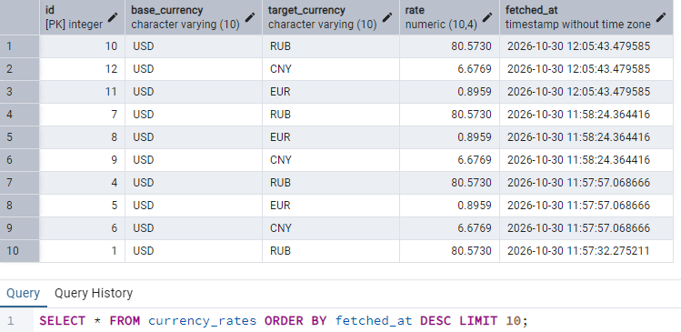
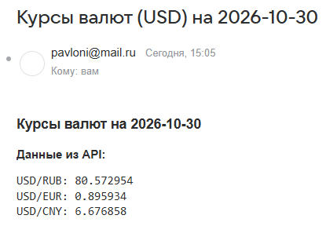

# Airflow E2E Pipeline: Currency Rates API → PostgreSQL → Email

Этот проект демонстрирует E2E-пайплайн оркестрации данных с использованием Apache Airflow. DAG автоматически забирает курсы валют через REST API, сохраняет их в PostgreSQL и отправляет уведомление на Email.

## Архитектура

## Стек технологий

- Оркестрация: Apache Airflow 2.8.1 (Docker)
- Язык: Python 3.11
- База данных: PostgreSQL 15
- Библиотеки: requests, psycopg2, airflow.providers.smtp

## Скриншоты работы

**1. Успешное выполнение DAG в Airflow:**

**2. Лог выполнения задачи fetch_currency_rates:**

**3. Данные в PostgreSQL (pgAdmin):**

**4. Результат отправки Email:**

## Как запустить локально

1. Установите Docker и Docker Compose.
2. Выполните `docker compose up -d`.
3. Откройте Airflow UI по адресу http://localhost:8080, включите DAG и нажмите Trigger DAG.
